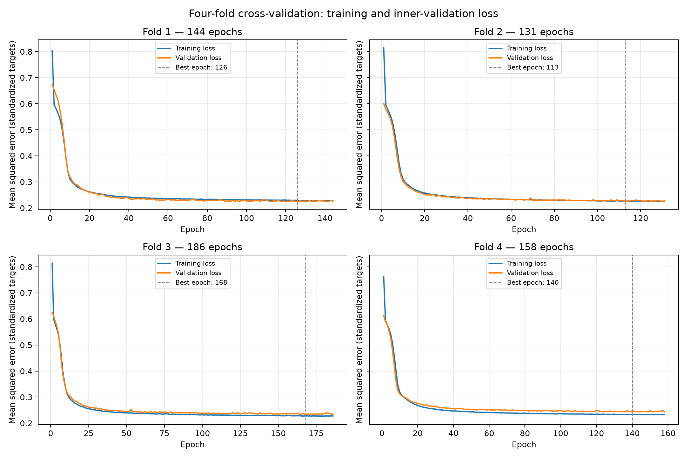
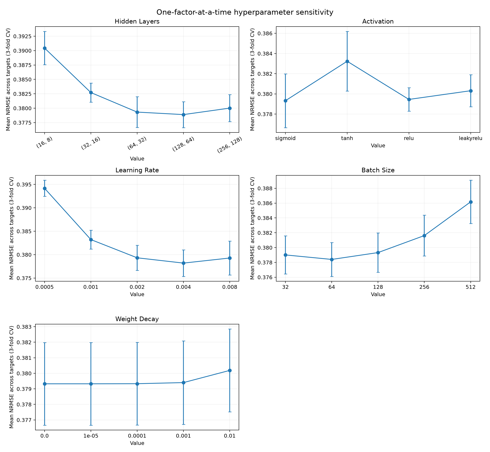
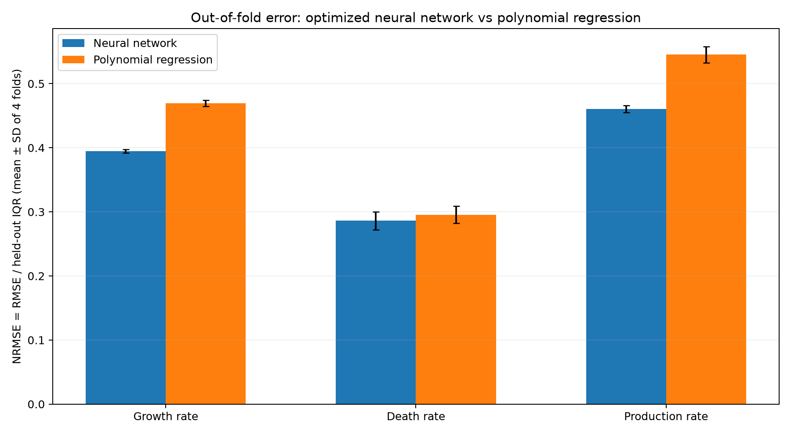

# Cell Culture Rate Prediction

This project develops and evaluates a fully connected neural network for predicting cell growth, cell death, and recombinant protein production rates in a simulated bioprocess. Seven measured culture conditions are used as inputs, including temperature, pH, nutrient concentrations, metabolic byproducts, and viable cell density. A reproducible PyTorch workflow optimizes network architecture and training hyperparameters, evaluates predictive accuracy using cross-validation, and investigates the effects of individual model settings. An independently optimized polynomial regression model provides a simpler point of comparison. The project exports quantitative results and publication-ready figures, supporting informed decisions about model performance, computational efficiency, and possible improvements to bioprocess monitoring.

## Highlights

- **Designed** a fully connected, multi-output PyTorch regression model with configurable hidden layers and nonlinear activations.
- **Optimized** five neural-network hyperparameters using a balanced, reproducible candidate search.
- **Evaluated** prediction errors using four-fold cross-validation, per-target RMSE, and interquartile-range-normalized RMSE.
- **Investigated** each hyperparameter through controlled three-fold cross-validation experiments and visual comparisons.
- **Benchmarked** the optimized neural network against tuned polynomial regression, exporting all figures and tables.

## Environment

The following versions were used to execute and verify the project:

- Python 3.13.5
- matplotlib 3.10.8
- numpy 2.3.5
- pandas 2.2.3
- scikit-learn 1.8.0
- torch 2.10.0 (CPU build)

Install the listed packages with `pip install -r requirements.txt` in an appropriate Python environment. Versions may differ in another computer's environment; the files above describe the versions actually used to produce the reported results.

## Code Design

### Repository structure and entry point

The repository follows a small, modular Python layout. `main.py` is the only required entry point and is executed from the repository root using `python main.py`. It imports the model from `src/classes.py`, fixed experiment definitions from `src/constants.py`, and reusable analysis functions from `src/functions.py`. `src/__init__.py` enables conventional package imports. All paths are resolved relative to the location of the project rather than the current terminal directory. The original dataset is retained, unchanged, in `datasets/dataset_cell_growth_7factor.csv`. Generated numerical results appear in `tables/`, and visualizations appear in `figures/`. This separation keeps the executable pipeline readable while allowing individual components to be tested, reused, and independently modified.

A developer can run `python main.py --mode smoke` to execute a short integration test on a 1,536-row subset. Smoke outputs are written to `tables/smoke/` instead of replacing completed results. The default `python main.py` command performs the full experiment with all 25,600 samples. Optional `--phase search`, `cv`, `sensitivity`, `polynomial`, and `plots` arguments allow selected stages to run separately. Result CSVs are appended after each fit and checked before rerunning, making it possible to resume an interrupted experiment. The final tables and figures are intended to be committed to version control so results can be examined without repeating expensive training.

### Data loading and validation

At the beginning of `main.py`, the dataset is loaded with pandas and divided into a predictor matrix `X` and target matrix `Y`. The seven predictors are temperature, pH, glucose, glutamine, lactate, ammonia, and viable cell density. The three regression outputs are the specific growth, death, and production rates. The columns are selected by their complete labels, preserving units and protecting against accidental changes in column order. The loader checks that every expected column is present, that all required values are numeric and finite, and that no values are missing. These checks prevent an incomplete dataset from silently entering the optimizer and make it easier to troubleshoot data problems when running the project in another environment.

### Data splitting and standardization

The workflow deliberately separates training, inner validation, and external evaluation subsets. The initial search uses a reproducible 80/20 split. For cross-validation, a `KFold` object creates four or three outer folds, and 10% of each outer training portion is reserved as an internal validation set. The inner validation data control training, while the untouched outer fold provides the reported prediction error. StandardScaler objects are fitted only to the samples used to train the model in each experiment. The same fitted transformations are then applied to the corresponding validation and evaluation inputs, preventing preprocessing information from leaking into the training stage.

Inputs are standardized because viable cell density is orders of magnitude larger than variables such as pH. The three targets are standardized separately because protein production, growth, and death rate measurements have different units and numerical ranges. Without output scaling, the sum-of-squares training objective could be disproportionately influenced by a single output. Predictions are transformed back to their original units before computing RMSE and normalized RMSE, making the final error metrics interpretable in the context of bioprocess performance.

### Building and training the neural network

The `FullyConnectedNeuralNetwork` class builds a PyTorch `nn.Sequential` model using the `hidden_layers` tuple. A hidden layer contains a linear transformation followed by the chosen `sigmoid`, `tanh`, `relu`, or `leakyrelu` activation. Because the task predicts continuous real-valued quantities, the final layer is linear and produces three outputs. Training uses the mean squared error of standardized targets and an AdamW optimizer. Its learning rate controls the step size while its weight decay discourages overly large parameters. A PyTorch `DataLoader` shuffles training samples and constructs mini-batches of the selected size before each epoch.

Each training iteration performs a forward pass, computes the batch loss, clears accumulated gradients, backpropagates derivatives, and updates weights through AdamW. After the epoch, the model enters evaluation mode and calculates the complete inner-validation loss without gradient tracking. Training and validation losses are retained as an epoch-by-epoch history. When validation loss improves, a deep copy of the model weights is saved; otherwise, a patience counter advances. After sustained lack of meaningful improvement, training stops, and the best-validation model is restored. This provides an explicit record of model convergence, limits unnecessary iterations, and avoids evaluating only the weights from an arbitrary final epoch.

### Hyperparameter search and model selection

The search candidate generator in `src/functions.py` builds a deterministic, balanced random sample of 24 unique combinations from a larger factorial search space. There are three possible architectures, four activation functions, three learning rates, three batch sizes, and three weight-decay levels. Independent shuffling ensures each individual level appears equally frequently across the sampled candidates. Every candidate is fitted using the same 80/20 split and evaluated using the arithmetic mean of three target-specific normalized RMSE values. The configuration with the lowest held-out validation score is stored in `tables/optimal_config.json` and used as the fixed reference setting for subsequent analyses.

### Cross-validation and hyperparameter sensitivity

The selected network is evaluated with four outer folds using independently fitted input and target scalers, model weights, and inner validation splits. The resulting per-fold RMSE, normalized RMSE, training duration, number of epochs, and convergence status are exported to `optimal_4fold_metrics.csv`. The complete training histories are saved in `optimal_4fold_loss.csv` and rendered as a two-by-two comparison of learning curves. Means and standard deviations across the four folds describe typical error and variability, rather than reporting only the best result from one random split.

Five controlled sensitivity experiments then vary one hyperparameter at a time while retaining the four other values from the selected model. Three outer folds are used for each configuration, with unchanged fold membership and repeatable random seeds. The architecture, learning rate, batch size, and weight-decay experiments each compare five levels, while all four requested activation functions are tested. Per-fold numerical results and summarized means and standard deviations are saved before plots are generated. Keeping these figures separate from training means that graphical changes never require repeating the neural-network fitting process.

### Polynomial baseline, reporting, and reproducibility

The comparison model is a scikit-learn polynomial regression pipeline containing input scaling, degree-one to degree-three polynomial feature generation, post-expansion feature scaling, and Ridge regression. Its polynomial degree and regularization strength are selected on the same 80/20 split used in the neural-network search, then evaluated using the same four outer folds as the network. The target scaler is learned only from the baseline's current training partition. This makes the evaluation procedures consistent and helps distinguish gains due to nonlinear neural-network representation from those achievable by a classical nonlinear regression model.

The shared scoring function computes RMSE separately for every target in its original units. For NRMSE, RMSE is divided by the interquartile range of the *corresponding held-out subset*. The three normalized errors are averaged to form the single optimization objective; no target receives an arbitrary larger weight. CSV exports preserve the data needed to reproduce all reported figures, while deterministic NumPy, scikit-learn, DataLoader, and PyTorch seeds improve repeatability on CPU hardware. Identical seeds cannot guarantee bit-for-bit equality across every PyTorch version or machine, so small numerical differences should be expected in other environments.

## Analysis

### Dataset characteristics and evaluation criteria

The simulation dataset contains 25,600 observations, seven predictors, and three response variables. It has no missing values or duplicate rows, so no imputation or record removal is necessary. However, the variable scales vary considerably. Viable cell density spans roughly 100,000 to 10 million cells/mL, while the specific death rate occupies a much smaller numerical interval. Standardizing both matrices within the relevant training fold is therefore essential for numerically stable learning and a loss that treats outputs more equally. Approximately 15.6% of the growth-rate values and 22.4% of the production-rate values are exactly zero, making the response distribution more complicated than a simple symmetric continuous variable and motivating nonlinear modeling without logarithmic target transformations. The dataset is simulated rather than collected from a production cell-culture process. This makes it suitable for comparing regression methods, but accuracy on these samples should not be interpreted as validated accuracy in an experimental bioreactor.

The primary performance measures are the root mean squared error (RMSE) and the normalized RMSE (NRMSE). For each target $j$, $\mathrm{RMSE}_j = \sqrt{\frac{1}{n}\sum_i (y_{ij}-\hat y_{ij})^2}$. Using interquartile-range normalization, $\mathrm{NRMSE}_j = \mathrm{RMSE}_j/(P_{75,j}-P_{25,j})$, where the percentiles are calculated from the held-out evaluation subset. Because the targets have different units, this normalization permits their errors to be compared on a shared dimensionless scale. The search objective is the mean of the three target-specific normalized errors. Each of the three cell-culture rates receives the same importance, which is appropriate in the absence of a more specific process-control priority. A lower value is better for both metrics.

### Search-space design and computational budget

The initial search deliberately evaluates 24 of the 324 combinations in the complete factorial design, rather than fitting all possible networks. The search levels are shown below. This strategy balances exploration with computational feasibility: a complete grid would require more than ten times as many model fits before the required sensitivity and cross-validation experiments even began.

| Hyperparameter | Candidate values | Rationale |
|---|---|---|
| `hidden_layers` | `(16, 8)`, `(32, 16)`, `(64, 32)` | Three progressively wider two-layer architectures measure capacity without starting with unnecessarily large models. |
| `activation` | `sigmoid`, `tanh`, `relu`, `leakyrelu` | All four requested nonlinearities are categorical choices, so no level was intentionally excluded. |
| `learning_rate` | `0.0005`, `0.001`, `0.002` | One-half, standard, and twice the common AdamW default probe the balance between slow and unstable optimization. |
| `batch_size` | `128`, `256`, `512` | Powers of two allow comparisons of update frequency and computational overhead with practical CPU batch sizes. |
| `weight_decay` | `0`, `0.001`, `0.01` | Zero regularization and two weak, logarithmically spaced penalties test whether shrinkage improves generalization. |

The architecture, learning rate, batch size, and weight decay each have three levels in the initial search because their candidate values can be ordered numerically or by number of trainable parameters. Activation has four levels because it is a category rather than a magnitude, and all four functions are explicitly relevant to this study. The generator creates exactly 24 unique candidates: every three-level factor appears eight times at each value and every four-level factor appears six times per value. This is not a complete or globally optimal search; it is a deliberately balanced fraction of the possible designs, with a fixed random seed so the candidate list can be regenerated. Narrower local sweeps after model selection provide additional information without paying the cost of an exhaustive five-dimensional search.

### Selected network and number of training epochs

The best of the 24 tested candidates used **`hidden_layers=(64, 32)`**, **`activation="sigmoid"`**, **`learning_rate=0.002`**, **`batch_size=128`**, and **`weight_decay=0.0`**. The measured validation NRMSE averaged across all three targets was **0.3761**. These values are called *optimal within the tested candidates*, not the true global optimum. They were selected because this combination gave the lowest observed mean validation error under the common split, optimizer, loss function, and training budget. The five top-ranked configurations were:

| Rank | Hidden layers | Activation | Learning rate | Batch size | Weight decay | Validation mean NRMSE |
|---:|---|---|---:|---:|---:|---:|
| 1 | `(64, 32)` | sigmoid | 0.002 | 128 | 0 | 0.3761 |
| 2 | `(64, 32)` | relu | 0.001 | 256 | 0.001 | 0.3766 |
| 3 | `(64, 32)` | sigmoid | 0.002 | 128 | 0.001 | 0.3767 |
| 4 | `(64, 32)` | leakyrelu | 0.002 | 256 | 0.01 | 0.3768 |
| 5 | `(64, 32)` | relu | 0.002 | 512 | 0.01 | 0.3773 |

In the screening search, **23 of 24** candidates reached their epoch limit without satisfying the early-stopping criterion. That is an explicit limitation of this resource-conscious screen: differences of only a few thousandths of an NRMSE unit between candidates should not be interpreted as definitive, and a longer finalist search could change their ranking.

Epoch counts were chosen in stages rather than setting the same costly limit for every experiment. The initial selection uses up to **90 epochs** per candidate, with early stopping after 18 epochs without a meaningful improvement once at least 35 epochs have elapsed. The final four-fold evaluation permits up to **260 epochs** because it is important to inspect whether the selected network continues to improve beyond the initial screening limit. The 3-fold controlled sensitivity experiments permit up to **110 epochs** to balance comparable training quality with the substantial total number of fits. In every experiment, the best validation weights are retained, rather than arbitrarily using the final weights. These choices control cost while retaining longer final training. The exact best and executed epochs are exported for inspection.

### Four-fold cross-validation of the selected model

Four-fold cross-validation estimates how reliably the selected settings generalize across held-out subsets of the simulated data. Three folds are used for model development in each iteration, with 10% of their combined observations reserved for the internal validation curve. The remaining fold is never used for fitting weights, scalers, or determining the best epoch. All target errors reported below are computed after restoring the best validation weights and converting predictions to original measurement units. The mean and sample standard deviation across the four test folds are:

| Target | RMSE mean ± SD | NRMSE mean ± SD |
|---|---:|---:|
| Growth rate | 0.02616 ± 0.00016 d⁻¹ | 0.3949 ± 0.0026 |
| Death rate | 0.00321 ± 0.00003 d⁻¹ | 0.2861 ± 0.0139 |
| Production rate | 2.44152 ± 0.00494 pg cell⁻¹ d⁻¹ | 0.4603 ± 0.0055 |

The average of the three per-target NRMSE values was **0.3804 ± 0.0064** across folds. Target-specific error is more informative than a single overall score: values for growth, death, and protein production can differ because each output has its own response surface, characteristic noise, and interquartile range. The raw RMSE retains the physical units, while NRMSE makes cross-target comparisons possible. 

*Figure 1. Four separate neural-network fits, each showing standardized training loss, internal validation loss, and the epoch with the lowest validation loss. These are not the outer-fold test errors.*

The recorded training schedules were fold 1: best epoch 126, stopped at 144; fold 2: best epoch 113, stopped at 131; fold 3: best epoch 168, stopped at 186; fold 4: best epoch 140, stopped at 158. All four runs stopped before the maximum number of epochs after their validation losses ceased making sustained improvements. This is evidence that the selected epoch budget was sufficient under the chosen validation-based stopping criterion; it is not proof of a global optimization minimum. The plotted loss values refer to mean squared error on standardized targets, so they are different from the normalized RMSE values reported above. Restoring the weights from each fold's lowest validation loss reduces the risk of using late-epoch overfitted weights. 

### One-factor-at-a-time hyperparameter influence

The experiments below change exactly one hyperparameter while keeping the other four at the selected baseline. For each option, the dataset is evaluated with the same three outer-fold partitions and model-development procedure. The table reports the arithmetic mean of three fold-level mean NRMSE values and the sample standard deviation. Lower is better. The data are also visualized as error bars in Figure 2. Because each analysis uses three folds instead of four, its numerical estimates are not expected to match the four-fold results exactly. Apparent differences smaller than fold-to-fold variation should not be treated as statistically significant.

| Hyperparameter | Level | Mean NRMSE ± SD (three folds) |
|---|---|---:|
| `hidden_layers` | `(16, 8)` | 0.3904 ± 0.0029 |
| `hidden_layers` | `(32, 16)` | 0.3827 ± 0.0017 |
| `hidden_layers` | `(64, 32)` | 0.3793 ± 0.0027 |
| `hidden_layers` | `(128, 64)` | 0.3789 ± 0.0023 |
| `hidden_layers` | `(256, 128)` | 0.3800 ± 0.0023 |
| `activation` | `sigmoid` | 0.3793 ± 0.0027 |
| `activation` | `tanh` | 0.3832 ± 0.0030 |
| `activation` | `relu` | 0.3803 ± 0.0018 |
| `activation` | `leakyrelu` | 0.3804 ± 0.0015 |
| `learning_rate` | `0.0005` | 0.3942 ± 0.0017 |
| `learning_rate` | `0.001` | 0.3832 ± 0.0020 |
| `learning_rate` | `0.002` | 0.3793 ± 0.0027 |
| `learning_rate` | `0.004` | 0.3782 ± 0.0028 |
| `learning_rate` | `0.008` | 0.3793 ± 0.0036 |
| `batch_size` | `32` | 0.3790 ± 0.0026 |
| `batch_size` | `64` | 0.3784 ± 0.0023 |
| `batch_size` | `128` | 0.3793 ± 0.0027 |
| `batch_size` | `256` | 0.3816 ± 0.0028 |
| `batch_size` | `512` | 0.3862 ± 0.0029 |
| `weight_decay` | `0.0` | 0.3793 ± 0.0027 |
| `weight_decay` | `1e-05` | 0.3793 ± 0.0027 |
| `weight_decay` | `0.0001` | 0.3793 ± 0.0027 |
| `weight_decay` | `0.001` | 0.3794 ± 0.0027 |
| `weight_decay` | `0.01` | 0.3802 ± 0.0027 |

*Figure 2. Average three-fold mean NRMSE with one standard deviation error bars, using the optimized configuration as the reference for each parameter.*

**Network architecture.** The five architectures include the selected reference, two networks with fewer trainable parameters, and two with more parameters. A smaller network may underfit a complex biochemical response surface, whereas a larger network may capture nonlinear interactions but require longer training and more regularization. The comparison therefore tests model capacity rather than blindly favoring the largest architecture. The lowest measured mean NRMSE in this sweep was **0.3789** for `(128, 64)`; the highest was **0.3904** for `(16, 8)`. The reference setting had mean NRMSE 0.3793. Across this sweep, mean fit duration ranged from 13.56 seconds at `(32, 16)` to 15.52 seconds at `(256, 128)`, providing direct evidence for the computational tradeoff.

**Activation function.** Sigmoid and tanh are smooth nonlinearities, but saturated regions can produce weak gradients. ReLU and LeakyReLU preserve stronger gradients for positive preactivations; LeakyReLU also retains a small slope for negative inputs. Comparisons therefore reflect both the representational form and how easily AdamW optimizes it. The lowest measured mean NRMSE in this sweep was **0.3793** for `sigmoid`; the highest was **0.3832** for `tanh`. The reference setting had mean NRMSE 0.3793.

**Learning rate.** The learning-rate sweep tests one-quarter, one-half, equal, twice, and four times the selected step size. Very small learning rates may leave training unfinished in a fixed epoch budget, while excessively high rates may oscillate or fail to settle. The lowest observed cross-validation error is the relevant criterion, rather than the fastest apparent decrease in training loss alone. The lowest measured mean NRMSE in this sweep was **0.3782** for `0.004`; the highest was **0.3942** for `0.0005`. The reference setting had mean NRMSE 0.3793.

**Batch size.** Batch size controls how often weights are updated per epoch and how noisy individual gradient estimates are. Smaller batches can improve exploration but impose more frequent Python and optimizer overhead. Larger batches are computationally efficient yet perform fewer optimizer updates during a fixed number of epochs, which can influence observed convergence. The lowest measured mean NRMSE in this sweep was **0.3784** for `64`; the highest was **0.3862** for `512`. The reference setting had mean NRMSE 0.3793. Across this sweep, mean fit duration ranged from 8.98 seconds at `512` to 28.89 seconds at `32`, providing direct evidence for the computational tradeoff.

**Weight decay.** Weight decay pulls model weights toward zero in the AdamW update and can help limit overfitting. However, excessive decay may suppress important nonlinear effects, while almost no penalty may permit larger fitted weights than necessary. The measured influence must be interpreted jointly with the learning rate and number of updates even though only decay was changed in this controlled sweep. The lowest measured mean NRMSE in this sweep was **0.3793** for `0.0`; the highest was **0.3802** for `0.01`. The reference setting had mean NRMSE 0.3793.

### Comparison with optimized polynomial regression

A polynomial regression baseline was tuned independently using input scaling, degree-one through degree-three feature expansions, and Ridge regularization values of 0.01, 1, and 100. This is **nine candidate combinations**, selected by the same holdout mean NRMSE scoring rule as the neural-network search. Its best candidate had **polynomial degree 3** and **Ridge alpha 1**, with screening NRMSE 0.4300. Both selected methods were then evaluated on identical four-fold partitions. The comparison is therefore more informative than comparing models trained on unrelated random splits, although both sets of hyperparameters were initially selected with data subsequently included in cross-validation.

| Target | Neural network NRMSE mean ± SD | Polynomial NRMSE mean ± SD |
|---|---:|---:|
| Growth rate | 0.3949 ± 0.0026 | 0.4692 ± 0.0047 |
| Death rate | 0.2861 ± 0.0139 | 0.2955 ± 0.0135 |
| Production rate | 0.4603 ± 0.0055 | 0.5454 ± 0.0125 |

The cross-validated overall mean NRMSE was **0.3804** for the neural network and **0.4367** for polynomial regression. The neural network had a lower mean NRMSE by 0.0563 (12.9% of the polynomial value). This suggests that the trained network captured relationships that the selected low-degree polynomial representation did not model as accurately, within the limitations of the experimental design. The relative rankings of the three individual targets in the table should also be examined; superior overall performance does not imply that one model is better for each cell-culture rate. In an application where underpredicting cell death is more consequential than overpredicting protein production, the three targets could be weighted differently rather than applying the simple equal-weight average used here.

*Figure 3. Held-out NRMSE mean and standard deviation across four identical outer folds; lower bars indicate lower errors.*

The average measured fit time per outer fold was **21.35 seconds** for the selected neural network and **0.07 seconds** for the polynomial baseline on the execution environment used here. These are per-fit measurements, not the total cost of model selection, and timings can change with CPU model, thread counts, and software versions. The network requires repeated mini-batch gradient updates across many epochs, while the polynomial pipeline estimates its coefficients using a regression solver after forming polynomial features. For this dataset and candidate space, the more elaborate PyTorch search and follow-up experiments also involve far more total model fits. Comparing predictive error against computation is therefore essential when considering deployment.

### Further optimization and limitations

With more computational resources, the next step would be to search around the lowest-error regions in Figure 2: more logarithmically spaced learning rates, different network depths, and broader combinations of batch size and weight decay. The controlled experiments intentionally isolate one factor at a time; a larger follow-up search would examine interactions because, for example, the best learning rate often depends on batch size and activation. A staged random search or Bayesian optimization could allocate extra fits to promising combinations without covering an entire factorial design. Repeated cross-validation with different random seeds would help establish whether apparent advantages exceed variation from network initialization and data splitting.

Another priority would be longer learning-curve experiments for any configuration whose validation error is still declining at the configured epoch limit. Training and validation errors should be inspected together to distinguish ongoing learning from overfitting. A learning-rate scheduler or longer training could help where validation loss still declines. If overfitting appears, stronger regularization or a smaller architecture could be tested. Repeated initializations or an ensemble might reduce variance, at additional computational cost.

Because the final regression layer is linear, predictions can in principle be negative even though the simulated rates are nonnegative; a future implementation could test nonnegative constraints or post-processing and evaluate their effect on error and calibration. More rigorous assessment would reserve a final untouched test dataset or use nested cross-validation: hyperparameters would be selected only within each outer training partition, then evaluated on observations excluded from the entire selection procedure. Here, the reported four-fold values are useful model-comparison estimates but are not a fully independent final-test estimate because hyperparameters were screened on a holdout from the same overall dataset. The data are simulated, and their observations may not represent independent operational batches or realistic process drift. A future experimental study should test model transfer to new batches, new equipment, and operating ranges not represented in training. Biochemical plausibility and performance near limits such as nutrient exhaustion are as important as low average error.

Production use would require calibration, uncertainty estimation, interpretation, and safeguards for out-of-domain inputs. Target-specific models or a weighted multi-output loss could prioritize the most important rate. Profiling and hardware acceleration could support further optimization. Overall, preprocessing, held-out evaluation, and reproducible computational budgets are more defensible than assuming a single architecture is universally best.

### Reproducible figures and data tables

All findings above are backed by exported CSV files: `tables/search_results.csv` (24 configurations), `tables/optimal_4fold_metrics.csv` (four-fold test errors), `tables/optimal_4fold_loss.csv` (complete learning curves), `tables/sensitivity_3fold_metrics.csv` (individual runs for every controlled setting), `tables/sensitivity_summary.csv` (three-fold means and standard deviations), `tables/polynomial_search.csv` (baseline tuning), `tables/polynomial_4fold_metrics.csv` (baseline cross-validation), and `tables/model_comparison.csv` (aligned comparison). `tables/optimal_config.json` records the selected configuration. To regenerate the graphics without refitting existing models, run `python main.py --phase plots`; to execute the full experiment from an empty results directory, run `python main.py`.
